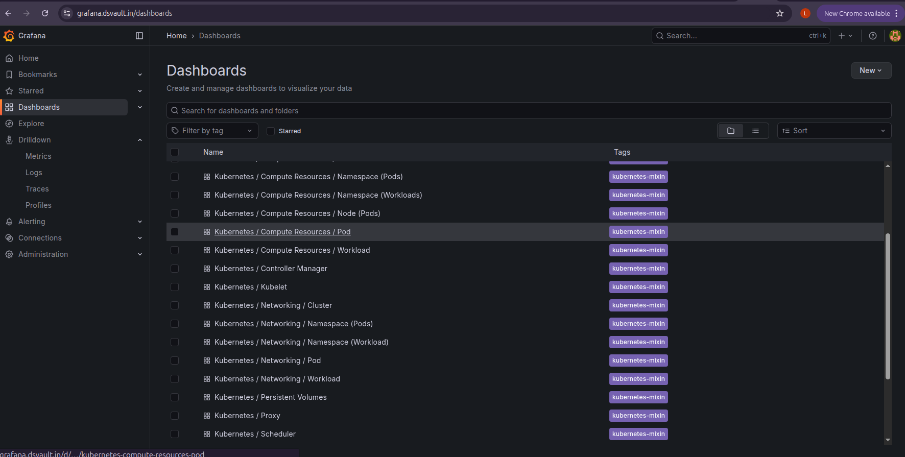
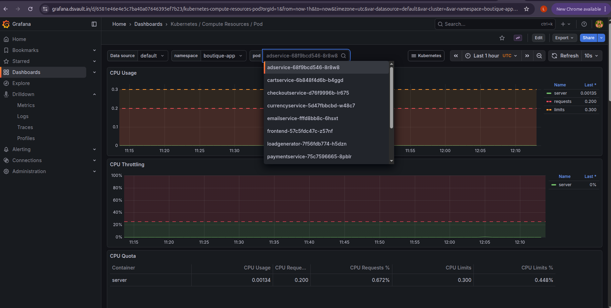
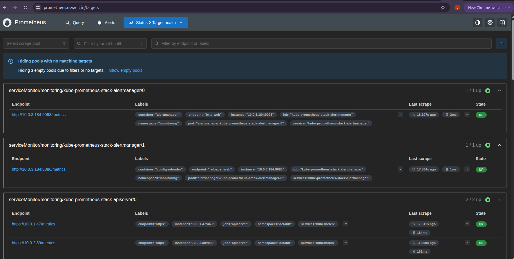
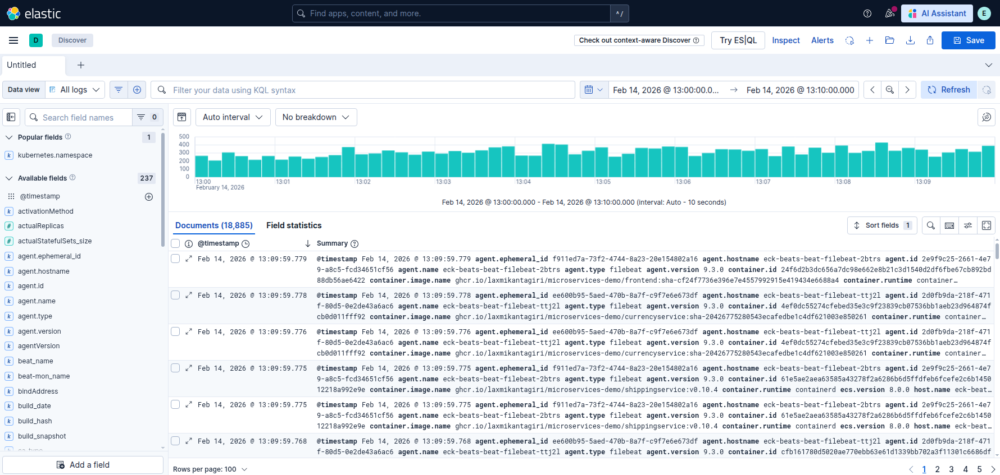

# Production-Style GitOps Platform on AWS EKS

A portfolio project demonstrating automated CI/CD, GitOps-based deployments, security scanning, and observability for a microservices application running on Amazon EKS.

> **Project scope:** The application is based on Google's [Online Boutique](https://github.com/GoogleCloudPlatform/microservices-demo) demo. My work focuses on the AWS infrastructure, CI/CD automation, GitOps workflow, security integration, and monitoring configuration. This is a portfolio project, not a continuously running production service.

## Table of Contents

- [Overview](#overview)
- [Architecture](#architecture)
- [Key Features](#key-features)
- [Technology Stack](#technology-stack)
- [Repository Structure](#repository-structure)
- [CI/CD Workflow](#cicd-workflow)
- [GitOps Deployment](#gitops-deployment)
- [AWS Infrastructure](#aws-infrastructure)
- [Security](#security)
- [Networking and Traffic Flow](#networking-and-traffic-flow)
- [Observability](#observability)
- [Horizontal Pod Autoscaling](#horizontal-pod-autoscaling)
- [Getting Started](#getting-started)
- [Validation and Testing](#validation-and-testing)
- [Challenges and Solutions](#challenges-and-solutions)
- [Troubleshooting](#troubleshooting)
- [Cost Management and Cleanup](#cost-management-and-cleanup)
- [Limitations and Future Improvements](#limitations-and-future-improvements)
- [Credits and License](#credits-and-license)

---

## Overview

This project demonstrates how to deploy and manage a multi-service application on AWS EKS using infrastructure as code, automated image builds, security checks, and GitOps-based delivery.

The application consists of multiple microservices. The platform automates the build and deployment workflow while providing monitoring, logging, and scaling capabilities.

### Project Objectives

- Provision AWS infrastructure using Terraform.
- Run Kubernetes workloads on Amazon EKS.
- Automate container builds with GitHub Actions.
- Scan images for vulnerabilities using Trivy.
- Store container images in GitHub Container Registry (GHCR).
- Synchronize Kubernetes deployments through Argo CD.
- Automate image updates using Argo CD Image Updater.
- Expose application traffic through AWS load balancing and Gateway API.
- Monitor application and cluster metrics with Prometheus and Grafana.
- Collect logs using the Elastic Cloud on Kubernetes (ECK) stack.

## Architecture

The platform combines AWS infrastructure, Kubernetes workloads, CI/CD automation, GitOps reconciliation, and observability.


### High-Level Workflow

1. A code change is pushed to the GitHub repository.
2. GitHub Actions identifies affected services.
3. The workflow builds container images for the affected services.
4. Trivy scans the images for vulnerabilities.
5. Images that pass the configured checks are pushed to GHCR.
6. Argo CD Image Updater detects eligible image versions according to its configured update policy.
7. Argo CD reconciles the desired application state with the Kubernetes cluster.
8. The AWS load balancer and Gateway API configuration route incoming traffic to the application.
9. Prometheus, Grafana, Alertmanager, and ECK provide monitoring, alerting, and logging.

> Exact behavior depends on the configured workflow conditions, image update policy, Argo CD write-back method, and Kubernetes manifests.

## Key Features

### Infrastructure as Code

- Terraform-managed AWS networking and infrastructure.
- Multi-Availability Zone VPC design.
- Private EKS cluster endpoint configuration.
- IAM roles and permissions for AWS resources.
- Bastion-host access for administration where configured.
- S3 remote state backend where configured.

### CI/CD Automation

- GitHub Actions workflows.
- Path-based change detection for microservices.
- Matrix builds for changed services.
- Docker Buildx for container image builds.
- Trivy vulnerability scanning.
- GHCR image publishing.

### GitOps

- Argo CD application synchronization.
- Automated reconciliation of desired Kubernetes state.
- Self-healing and pruning where enabled.
- Argo CD Image Updater for eligible image updates.
- Separation of application source and deployment configuration where configured.

### Monitoring and Logging

- Prometheus for metrics collection.
- Grafana for dashboards.
- Alertmanager for alert routing.
- ECK-based centralized logging where configured.
- Horizontal Pod Autoscaler for selected workloads.

## Technology Stack

| Category | Technologies |
|---|---|
| Cloud | AWS |
| Infrastructure as Code | Terraform |
| Containerization | Docker, Docker Buildx |
| Orchestration | Kubernetes, Amazon EKS |
| CI/CD | GitHub Actions |
| Container Registry | GitHub Container Registry |
| Security | Trivy, IAM |
| GitOps | Argo CD, Argo CD Image Updater |
| Networking | VPC, ALB, Gateway API, Route 53, ACM |
| DNS Automation | external-dns |
| Monitoring | Prometheus, Grafana, Alertmanager |
| Logging | Elasticsearch, Kibana, Filebeat, ECK |
| Autoscaling | Horizontal Pod Autoscaler |
| Application | Google Online Boutique |

*The table lists technologies used or configured by the project. Confirm each component against the current repository before describing it as fully operational.*

## Repository Structure

The following is a logical overview of the main directories. Actual filenames and directory names may differ.

```text
Microservices-Deployment/
├── terraform/
├── .github/
│   └── workflows/
├── argocd/
├── gateway-api-manifests/
├── external-dns/
├── observability/
├── scaling/
├── kubernetes-manifests/
├── helm-chart/
├── kustomize/
├── src/
├── docs/
│   └── images/
└── README.md
```

| Directory | Purpose |
|---|---|
| `terraform/` | AWS infrastructure definitions |
| `.github/workflows/` | CI/CD automation |
| `argocd/` | Argo CD application configuration |
| `gateway-api-manifests/` | Gateway API resources |
| `external-dns/` | DNS automation configuration |
| `observability/` | Monitoring and logging configuration |
| `scaling/` | Autoscaling resources |
| `kubernetes-manifests/` | Kubernetes deployment resources |
| `helm-chart/` | Helm charts, if used |
| `kustomize/` | Kustomize overlays, if used |
| `src/` | Application source code |
| `docs/images/` | Architecture and monitoring screenshots |

## CI/CD Workflow

GitHub Actions automates the container build and publishing process.

### Workflow Steps

1. Detect changed application paths.
2. Identify the services affected by the changes.
3. Build images for the selected services.
4. Run configured Trivy security scans.
5. Apply the workflow's configured security thresholds.
6. Push approved images to GHCR.
7. Make eligible image tags available to the GitOps deployment process.

### Change Detection and Matrix Builds

Path-based change detection helps avoid rebuilding every microservice after an unrelated change.

A dedicated change-detection job can generate a JSON matrix for downstream jobs. This allows the workflow to build only the services identified by the detection step.

### Image Tagging

Use traceable image tags, such as commit-based tags, so that a deployment can be associated with a specific source revision.

For example:

```text
ghcr.io/OWNER/IMAGE:sha-COMMIT_SHA
```

Replace `OWNER`, `IMAGE`, and `COMMIT_SHA` with the actual registry owner, image name, and commit identifier.

### Security Gate

Trivy can scan container images for vulnerabilities. Configure the workflow to fail when findings meet the project's selected severity and policy thresholds.

A successful build does not, by itself, prove that an image is vulnerability-free.

## GitOps Deployment

Argo CD manages application deployment by reconciling Kubernetes resources against the desired state defined in the configured Git repository.

### Deployment Flow

1. GitHub Actions builds and publishes a new image.
2. Argo CD Image Updater evaluates available tags against its configured update strategy.
3. The configured write-back method updates application parameters or Git-managed deployment configuration.
4. Argo CD detects the desired-state change.
5. Argo CD synchronizes the resources according to the application's sync policy.
6. Kubernetes runs the updated workloads.

### Automated Reconciliation

Where enabled:

- **Self-healing** helps reconcile manual changes that differ from the declared desired state.
- **Pruning** removes managed resources that are no longer declared in the desired configuration.
- **Automated synchronization** applies eligible desired-state changes without requiring a manual sync.

These settings should be confirmed in the actual Argo CD application configuration.

### Important Distinction

Argo CD Image Updater identifies and promotes eligible image versions according to its policy. Argo CD then reconciles the desired Kubernetes state. The exact process depends on whether image updates are written back to Git or maintained through application parameters.

## AWS Infrastructure

Terraform is used to define and manage the AWS infrastructure.

### Infrastructure Components

- **VPC:** Network isolation and subnet organization.
- **Multiple Availability Zones:** Supports a resilient network design.
- **Private subnets:** Host private workloads and resources where configured.
- **Amazon EKS:** Runs the Kubernetes control plane and workloads.
- **IAM:** Controls access to AWS resources.
- **Bastion host:** Provides a controlled administrative access path where configured.
- **S3 backend:** Stores Terraform state remotely where configured.
- **Application Load Balancer:** Handles configured application ingress.
- **Route 53:** Provides DNS records.
- **AWS Certificate Manager:** Supplies certificates for configured TLS endpoints.

### Terraform State

If Terraform uses an S3 backend, configure the bucket, state key, region, and any locking mechanism supported by the Terraform/backend version in use.

Do not commit Terraform state files, credentials, or secret values to Git.

### Infrastructure Changes

Before applying Terraform changes:

1. Review the Terraform configuration.
2. Initialize the working directory.
3. Review the proposed plan.
4. Apply only after confirming the planned resource changes.

Example commands, to run from the directory containing the relevant Terraform root module:

```bash
terraform init
terraform fmt -check
terraform validate
terraform plan
```

Apply only when you have reviewed the plan and confirmed the target AWS account and region:

```bash
terraform apply
```

These commands are examples. Your repository may require a specific Terraform root directory, backend configuration, variable file, or module initialization sequence.

## Security

Security is considered throughout infrastructure provisioning, image creation, and deployment.

### Security Measures

- IAM roles and least-privilege permissions where configured.
- Private EKS API endpoint where configured.
- Trivy vulnerability scanning.
- Protected credentials using GitHub Actions secrets or appropriate AWS identity mechanisms.
- Restricted network access.
- TLS certificates for configured application endpoints.
- Private subnets for workloads where applicable.

### Security Checklist

- [ ] No AWS access keys or tokens are committed to Git.
- [ ] No passwords or private keys are stored in README files.
- [ ] Terraform state is protected.
- [ ] GitHub Actions permissions are limited to what each workflow needs.
- [ ] Image scans run before publishing or deployment, according to the intended policy.
- [ ] The bastion host is restricted to trusted administrative access.
- [ ] EKS authentication and Kubernetes RBAC are configured appropriately.
- [ ] Public ingress exposes only the intended application endpoints.
- [ ] Kubernetes secrets are not committed in plaintext.

A private EKS API endpoint reduces public API exposure, but it does not replace IAM authentication, Kubernetes authorization, or network access controls.

## Networking and Traffic Flow

The intended request flow is:

```text
User / Browser
      |
      v
Route 53 DNS
      |
      v
AWS Application Load Balancer
      |
      v
Gateway API resources
      |
      v
Kubernetes Services
      |
      v
Application Pods
```

### TLS

AWS Certificate Manager provides certificates for the configured TLS endpoint. The exact TLS termination point depends on the load balancer and Gateway API configuration.

ACM is not a separate network hop; it supplies certificate material to the component terminating TLS.

### Private Cluster Access

If the EKS API endpoint is private, administrative tools such as `kubectl` and Helm must run from a network location with connectivity to that endpoint.

A bastion host may provide that access path when configured. Restrict its inbound access and use appropriate IAM permissions and Kubernetes authorization.

### Gateway API

Verify the Gateway API resources, controller version, and AWS Load Balancer Controller configuration used by the repository. The supported API kinds and controller behavior depend on the installed versions and configuration.

## Observability

The project includes monitoring and logging components intended to help inspect application health and troubleshoot deployments.

### Prometheus

Prometheus collects metrics from configured targets.

Examples of useful checks include:

- Target health.
- Pod CPU and memory metrics.
- Application metrics, where instrumented.
- Kubernetes workload health.

### Grafana

Grafana presents metrics through dashboards.

The screenshots below illustrate the monitoring views captured for the project.

#### Grafana Dashboards



#### Pod CPU Metrics



#### Prometheus Targets



### Alertmanager

Alertmanager routes alerts to configured receivers, such as Slack, when the required alert rules and integrations are in place.

#### Alerting Checklist

- [ ] Alert rules are loaded.
- [ ] Alertmanager receivers are configured.
- [ ] Slack credentials are stored securely.
- [ ] A test alert reaches the intended receiver.
- [ ] Alert delivery is verified rather than assumed from configuration alone.

### Centralized Logging

The ECK stack can provide centralized log storage and search through Elasticsearch and Kibana, with Filebeat or other configured collectors forwarding logs.

#### Kibana Log Discovery



The screenshot demonstrates the logging interface captured for the project. Actual log availability depends on collector configuration, permissions, and the status of the logging stack.

## Horizontal Pod Autoscaling

The project includes Horizontal Pod Autoscaler configuration for selected workloads.

HPA adjusts replica counts based on the configured metrics and resource targets, provided the required metrics pipeline and workload configuration are available.

For CPU-based scaling, verify:

- The Deployment specifies appropriate CPU requests.
- The metrics server or relevant metrics adapter is working.
- The HPA targets the correct workload.
- The minimum and maximum replica counts are appropriate.
- The cluster has sufficient capacity to schedule additional replicas.

Example inspection commands:

```bash
kubectl get hpa -A
kubectl describe hpa <hpa-name> -n <namespace>
kubectl get deployments -A
kubectl get pods -A
```

Replace the placeholders with the actual HPA name and namespace.

## Getting Started

> **Important:** This section provides a general deployment sequence. It is not a guaranteed copy-and-run procedure for every repository configuration. Verify the Terraform root module, variable names, GitHub Actions secrets, Helm values, and Argo CD manifests before deployment.

### Prerequisites

Install and configure the tools required by your actual workflow:

- AWS CLI
- Terraform
- kubectl
- Helm, if the repository uses Helm
- Git
- Docker, if building images locally
- An AWS account with appropriately scoped permissions
- A GitHub account and access to the repository
- A GHCR token or supported authentication method, if required
- A domain and DNS access, if using a custom domain

### Step 1: Clone the Repository

```bash
git clone https://github.com/Nafees-khan-29/Microservices-Deployment.git
cd Microservices-Deployment
```

### Step 2: Configure AWS Access

Configure the AWS CLI using an approved authentication method, preferably temporary credentials or an appropriate IAM role.

```bash
aws sts get-caller-identity
aws configure get region
```

Verify the account and region before provisioning any resources. Do not paste credentials into the README or commit them to Git.

### Step 3: Configure Terraform

Navigate to the Terraform root module used by this project. For example, if the root module is in `terraform/`:

```bash
cd terraform
terraform init
terraform fmt -check
terraform validate
terraform plan
```

Review the plan and supply required variables using your actual configuration. Do not assume that a sample variable filename or variable name exists in the repository.

### Step 4: Provision Infrastructure

After verifying the plan and confirming the AWS account and expected cost:

```bash
terraform apply
```

Wait for the infrastructure to finish provisioning. Follow the output and deployment notes in the Terraform configuration.

### Step 5: Configure Kubernetes Access

For an EKS cluster, use the actual cluster name and region from the Terraform outputs or AWS console.

Example:

```bash
aws eks update-kubeconfig \
  --region <aws-region> \
  --name <eks-cluster-name>

kubectl get nodes
kubectl get namespaces
```

If the EKS API is private, run these commands from a machine that has network connectivity to the endpoint, such as an appropriately configured bastion or connected administration environment.

### Step 6: Install and Configure Platform Components

Follow the repository's actual installation order for:

1. Required Kubernetes APIs and controllers.
2. AWS Load Balancer Controller and Gateway API resources, if used.
3. DNS automation, if used.
4. Argo CD.
5. Argo CD Image Updater, if used.
6. Monitoring and logging components.
7. Application resources.

The correct order depends on the manifests and dependencies in your repository. Do not apply all folders blindly; review their contents and prerequisites first.

### Step 7: Configure CI/CD

Review the GitHub Actions workflows under `.github/workflows/`.

Confirm:

- Which branches and paths trigger the workflow.
- Which services are selected by change detection.
- How the workflow authenticates to GHCR.
- How Trivy scan results affect the build.
- How image tags are generated.
- How the GitOps deployment is updated.

Add only the secrets and variables actually required by the workflow. Never place their values in source control.

### Step 8: Verify Deployment

Use the actual namespace and resource names from your manifests.

```bash
kubectl get deployments -A
kubectl get pods -A
kubectl get services -A
kubectl get ingress -A
kubectl get hpa -A
```

If the project uses Gateway API, inspect its resources too:

```bash
kubectl get gatewayclass
kubectl get gateways -A
kubectl get httproutes -A
```

Check Argo CD application health through its UI or CLI if installed and accessible.

### Step 9: Verify Application Access

After the load balancer, DNS, and TLS configuration are ready:

1. Check the relevant load balancer status.
2. Verify that DNS resolves to the intended endpoint.
3. Confirm that the TLS certificate is valid.
4. Open the configured application URL.
5. Check application and controller logs if the endpoint is unavailable.

Do not assume the application is publicly reachable simply because the Kubernetes resources were created.

## Validation and Testing

Use the following checklist to document what has actually been tested.

| Area | Validation |
|---|---|
| Terraform | Initialization, validation, and plan complete successfully |
| EKS | Cluster access and expected nodes are available |
| CI/CD | A test commit triggers the expected workflow |
| Change detection | Only intended services are selected |
| Security | Scan results follow the configured failure policy |
| GHCR | Expected image and tag are published |
| GitOps | Argo CD reports the expected application sync and health state |
| Networking | Gateway and load balancer route traffic correctly |
| DNS/TLS | The configured hostname resolves and HTTPS works |
| Autoscaling | HPA metrics and replica changes behave as expected |
| Monitoring | Expected Prometheus targets are healthy |
| Logging | Expected application logs appear in Kibana |
| Alerting | A test alert reaches the configured receiver |

Mark an item as complete only after validating it. Configuration files and screenshots alone do not prove that a workflow or integration still works.

## Challenges and Solutions

### 1. Image Tag Matching

**Challenge:** Image Updater may not recognize image tags when its configured allow-list or tag filter does not match the tags generated by CI.

**Solution:** Align the image tagging convention and Image Updater's configured tag-selection policy. If using commit-based tags, confirm that the configured pattern matches the actual published tags.

### 2. Private EKS API Access

**Challenge:** `kubectl` and Helm cannot reach a private EKS endpoint from a machine outside the permitted network.

**Solution:** Run administration commands from an authorized network location with connectivity to the endpoint. Maintain appropriate IAM permissions and Kubernetes RBAC.

### 3. Efficient Microservice Builds

**Challenge:** Rebuilding all services for every source change increases CI execution time.

**Solution:** Use a change-detection step and a dynamic matrix to select the affected services, while ensuring shared dependencies and workflow configuration changes trigger the appropriate builds.

### 4. GitOps Reconciliation

**Challenge:** Manual cluster changes can differ from the configuration managed in Git.

**Solution:** Use Argo CD reconciliation and enable self-healing or pruning only where their behavior is appropriate for the application.

## Troubleshooting

### Pods Are Not Starting

```bash
kubectl get pods -A
kubectl describe pod <pod-name> -n <namespace>
kubectl logs <pod-name> -n <namespace>
```

Check image pull errors, resource limits, missing configuration, and scheduling events.

### Argo CD Is Not Syncing

Check:

- Repository access and credentials.
- Application destination and namespace.
- Git revision and resource paths.
- Sync policy and health status.
- Image Updater configuration and write-back method.

### Application URL Is Unavailable

Check:

- Load balancer controller health.
- Gateway and route status.
- Service selectors and endpoints.
- DNS records.
- TLS certificate and listener configuration.
- Security groups, subnet routing, and network access.

### Prometheus Targets Are Down

Check the scrape configuration, target labels, service discovery, network reachability, and the health of the monitored endpoint.

### Images Are Not Updating

Check the published image tags, GHCR permissions, image update filters, Argo CD Image Updater logs, Git write-back permissions where applicable, and the Argo CD sync status.

## Cost Management and Cleanup

AWS resources can continue generating charges even when the application receives no traffic. The infrastructure is not intended to run continuously.

### Before Deployment

- Review estimated charges for EKS, NAT Gateways, load balancers, EC2, storage, and data transfer.
- Use AWS Budgets or billing alerts where appropriate.
- Avoid deploying resources you do not need for the test.
- Keep credentials and Terraform state protected.

### Cleanup

If Terraform manages the deployed resources, first review what Terraform will destroy.

From the correct Terraform root directory:

```bash
terraform plan -destroy
```

If the plan is correct and you intend to remove the infrastructure:

```bash
terraform destroy
```

Follow the repository's teardown instructions for resources managed outside Terraform. Confirm that you are using the correct AWS account, region, workspace, and state before destroying anything.

Some resources, such as non-empty S3 buckets or resources created manually, may require separate cleanup. Verify that no resources remain that could continue to incur charges.

## Limitations and Future Improvements

Potential future improvements include:

- Separate development, staging, and production environments.
- Stronger Kubernetes network isolation through NetworkPolicies.
- Policy enforcement with OPA Gatekeeper or a similar policy engine.
- Centralized secrets management.
- Improved deployment rollback and release verification.
- Additional security checks and supply-chain attestations.
- More comprehensive automated integration tests.
- Cluster capacity optimization and autoscaling improvements.
- Documented disaster recovery and infrastructure restoration procedures.

These are future improvements, not claims that the features are already implemented.

## Credits and License

### Application

The application is based on [GoogleCloudPlatform/microservices-demo](https://github.com/GoogleCloudPlatform/microservices-demo), also known as Online Boutique.

The upstream project is distributed under the Apache License 2.0. Refer to the upstream repository for its license and attribution requirements.

### Infrastructure and Automation

The AWS infrastructure, CI/CD, GitOps, security, and observability configurations are the focus of this portfolio project.

Ensure that this repository contains an appropriate license file for your own contributions and that any third-party components retain their required license notices.

---

## Author

**Nafees Khan**

DevOps Engineer | Cloud Infrastructure | CI/CD | Kubernetes

- GitHub: [Nafees-khan-29](https://github.com/Nafees-khan-29)
- Microservices Deployment Project: [Microservices-Deployment](https://github.com/Nafees-khan-29/Microservices-Deployment)

---

*Built as a hands-on DevOps portfolio project to practice infrastructure as code, cloud-native deployments, GitOps, security automation, and observability.*
