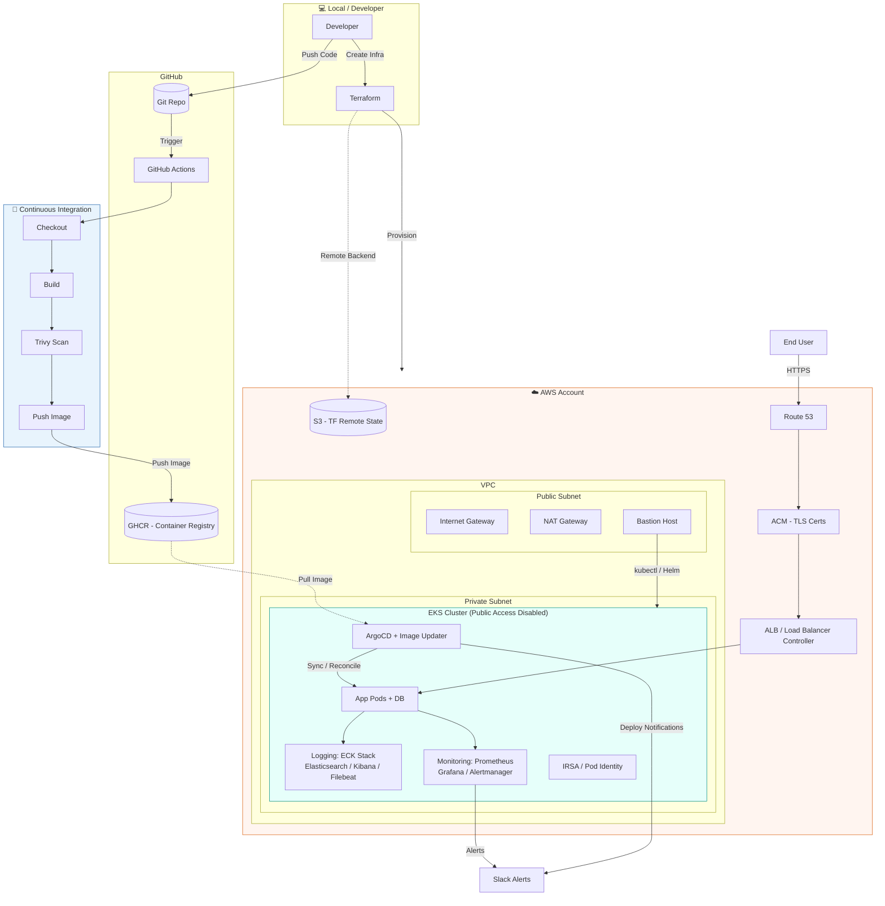

## 🏗️ Architecture

A production-style GitOps pipeline on AWS EKS — Terraform for infrastructure, GitHub Actions for CI, ArgoCD for CD, and a full observability stack (ECK + Prometheus/Grafana) with Slack alerting.

### Pipeline Flow

1. **Infra Provisioning** — Terraform stands up the VPC, EKS cluster, IAM roles, ALB, Route 53, and ACM certs, with remote state in S3.
2. **CI (GitHub Actions)** — On push, the pipeline checks out code, builds the image, scans it with **Trivy**, and pushes it to **GHCR**.
3. **CD (ArgoCD)** — ArgoCD + Image Updater watches the registry/manifests and reconciles the cluster state automatically (GitOps — no manual `kubectl apply`).
4. **Traffic** — Route 53 → ACM (TLS) → ALB / Gateway API → services → pods running in a private subnet (no public EKS API access).
5. **Observability** — ECK stack (Elasticsearch, Kibana, Filebeat) handles logs; Prometheus, Grafana, and Alertmanager handle metrics and alerting.
6. **Notifications** — Deployment and alert events are pushed to **Slack** in real time.

### Tech Stack

| Layer | Tools |
|---|---|
| IaC | Terraform (S3 remote backend) |
| CI | GitHub Actions, Trivy (vulnerability scanning), GHCR |
| CD | ArgoCD, ArgoCD Image Updater |
| Orchestration | AWS EKS (private cluster), Kubernetes Gateway API |
| Networking | VPC, ALB, NAT/Internet Gateway, Route 53, ACM |
| Logging | ECK Stack (Elasticsearch, Kibana, Filebeat, ECK Operator) |
| Monitoring | Prometheus, Grafana, Alertmanager |
| Security | IRSA / Pod Identity, private EKS API endpoint |
| Alerting | Slack |
